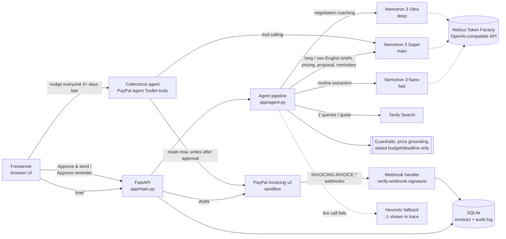

# Scope2Cash

**From a messy client brief to a paid invoice: an AI agent that scopes, prices with cited market data, and bills by milestone through PayPal, with a human approving every outbound step.**

Freelance developers and designers lose hours, and money, turning "here's what we want..." into a scoped, fairly priced, milestone-based quote, and then chasing payment. Scope2Cash runs that whole pipeline:

1. **Scope.** Paste an email, chat, or job post. The agent extracts milestones, deliverables, hours, assumptions, risks, the client's stated budget and deadline, and the questions to ask before committing. A *brief completeness* score warns when the brief is too thin to quote.
2. **Market price.** Tavily web research plus a model-synthesized hourly range. A guardrail only accepts a range that is backed by figures found in the cited sources; otherwise it is labelled an unverified placeholder.
3. **Quote.** Value, market, or premium positioning; milestone line items with due dates; a proposal message; and negotiation coaching, including a reduced-scope option when the quote is over the client's budget.
4. **Get paid.** One PayPal invoice draft per milestone. You **approve** each one before it is sent. Statuses (sent, partially paid, paid, overdue) sync from PayPal.
5. **Follow up.** Overdue invoices get a reminder draft whose tone escalates with days late. You review it, then approve PayPal's official reminder and/or send the personal note yourself.
6. **Pipeline + collections agent.** Every invoice across every client in one AG Grid table, kept current by verified PayPal webhooks. Ask the collections agent, which runs on the official **PayPal Agent Toolkit**, things like "nudge everyone more than 3 days late". It reads PayPal and queues reminders or cancellations for your approval.

Nothing reaches a client without a click from you, and every approval is written to an audit log.

## How NVIDIA Nemotron and Nebius Token Factory are used
All model calls go through Nebius Token Factory's OpenAI-compatible API (`POST /v1/chat/completions`, see `app/adapters/llm.py`). Each step is routed by difficulty so the app stays responsive and credits stretch:

| Step | Tier | Default model (Token Factory ID) |
|---|---|---|
| Scope extraction, routine briefs | fast | `nvidia/NVIDIA-Nemotron-3-Nano-30B-A3B` |
| Scope extraction, long or non-English briefs (auto-escalated) | main | `nvidia/nemotron-3-super-120b-a12b` |
| Price synthesis from sources, proposal, reminders | main | `nvidia/nemotron-3-super-120b-a12b` |
| Negotiation coaching (budget gaps, timeline, risk trade-offs) | deep | `nvidia/Nemotron-3-Ultra-550b-a55b` |

Reliability features around the model calls:
- **JSON mode** (`response_format: {"type": "json_object"}`), automatically disabled per model if the endpoint rejects it.
- **Validation and one repair round.** Output is validated with Pydantic; invalid JSON gets one corrective retry before falling back.
- **Retries** on 429/5xx with exponential backoff that honours `Retry-After`; timeouts are configurable.
- **Startup model check.** When a key is present, `GET /v1/models` verifies the configured IDs and resolves near-misses (for example a missing `NVIDIA-` prefix). Problems show in `/api/health` and as a banner in the UI.
- **Visible fallback.** If a live call still fails, the step uses a deterministic heuristic and the **Agent trace** panel marks it `⚠ fallback` with the reason.

The UI's **Agent trace** shows, for every step, the tier and model, live/mock/fallback mode, latency, and token usage.

## How Tavily is used
`app/adapters/search.py` calls `POST https://api.tavily.com/search` with two targeted queries per quote (an hourly-rate query for the role, and a fixed-price query built from the scoped milestones). Results are de-duplicated, ranked by score, and passed to Nemotron as numbered sources. The price card shows the sources, the exact queries, and the dollar figures found in them. The **grounding guardrail** (`app/heuristics.py: ground_pricing`) clamps any model range that strays outside that evidence, and flags the price as unverified when the sources contain no hourly figures at all.

## How PayPal is used
`app/adapters/payments.py` implements the PayPal Invoicing API v2 against PayPal's published OpenAPI spec: OAuth client credentials (token cached), `generate-next-invoice-number`, create draft (`Prefer: return=representation`, `PayPal-Request-Id` for idempotent retries), send (human-approved), get (status, payer link, amount due), and remind (human-approved). The returned invoice amount is reconciled against the quote. Mock drafts created during a fallback stay clearly labelled `INV2-MOCK-…`. A failed live **send** is always an error, never a faked success.

### Verified webhooks (`POST /api/paypal/webhook`, `app/webhooks.py`)
- Handles `INVOICING.INVOICE.PAID`, `.CANCELLED`, `.REFUNDED`, `.UPDATED` and `.SENT`. Other event types are acknowledged and ignored.
- **Signature check through PayPal's own API.** Every delivery is checked with `POST /v1/notifications/verify-webhook-signature`. The request is built from the `PAYPAL-AUTH-ALGO`, `PAYPAL-CERT-URL`, `PAYPAL-TRANSMISSION-ID`, `PAYPAL-TRANSMISSION-SIG` and `PAYPAL-TRANSMISSION-TIME` headers, your `PAYPAL_WEBHOOK_ID`, and the event. The event is forwarded **byte-for-byte** as received, which is what that API needs. Anything other than `verification_status: SUCCESS` gets a 400 and is written to the audit log.
- **Built for PayPal's delivery model.** PayPal delivers at least once, retries for up to 3 days, and doesn't guarantee order. So events are deduplicated by event id, a late or older event can't undo a terminal status, and after a verified event the invoice is re-fetched with `GET /v2/invoicing/invoices/{id}` instead of trusting the payload.
- **Offline mode.** The ⏩ demo buttons send HMAC-signed *mock* events through the same pipeline. Mock-signed events can only change mock invoices, so they can never move a real PayPal invoice. Bodies are capped at 512 KB.

### Collections agent on the PayPal Agent Toolkit (`app/paypal_agent.py`)
- Tool definitions come from PayPal's official [`paypal-agent-toolkit`](https://pypi.org/project/paypal-agent-toolkit/) (1.11.0, Apache-2.0): `list_invoices`, `get_invoice`, `send_invoice_reminder` and `cancel_sent_invoice`. That means PayPal's own names, descriptions and Pydantic argument schemas.
- Those tools are handed to **Nemotron Super through Nebius function calling** (`tools`, `tool_choice: "auto"`), and the agent loop runs here.
- **Reads run immediately.** Calls go through the toolkit's own `execute` handlers.
- **Writes are never executed by the model.** They become *proposals*. Each one is validated against the toolkit's schema and checked by guardrails: the invoice must be in your pipeline, must be in an unpaid state, and must have a sandbox-only recipient in public-demo mode. Only **Approve** runs it, and the guardrails are re-checked at that point.
- Without a key (or if the live loop fails, which the UI shows), a deterministic planner drives the same toolkit tools.
- Why only the shared core: the toolkit's framework adapters (OpenAI Agents SDK, LangChain, CrewAI) pin old versions that can't be installed on Python 3.13. So it's installed with `--no-deps` (see `requirements-paypal-toolkit.txt`) and only the framework-neutral core is used. The orchestration is OpenAI-compatible tool calling, which works with any provider.

### Pipeline view (AG Grid Community)
`app/static/pipeline.js` uses [AG Grid Community](https://www.ag-grid.com/) 36.2.0 (MIT), version-pinned from the jsDelivr CDN.
- **Scoreboard:** collected, awaiting, overdue and drafts.
- **Table:** a Quartz theme in PayPal blue, quick search, unpaid/overdue/paid/draft filters, pinned client and action columns, a totals row, late-row highlighting, and inline actions (approve & send, draft a reminder, simulate payment).
- **Side panels:** the agent and the webhook feed.
- **Load sample clients** adds 8 clearly labelled fictional invoices. If the CDN can't be reached, the same columns render as a plain table.

### Receiving real sandbox webhooks
1. Deploy the app somewhere with a public HTTPS URL (see Deploy).
2. In the PayPal Developer Dashboard, open your sandbox app → *Webhooks* → *Add webhook*. Use `https://<your-host>/api/paypal/webhook` and pick the `Invoicing` events above.
3. Copy the webhook ID into `PAYPAL_WEBHOOK_ID`.
4. Pay an invoice as a sandbox buyer. The row turns PAID, and the event appears as "verified by PayPal".

Note: the dashboard's *Webhooks simulator* sends events that can't be verified by postback, so expect those to be rejected.

## What runs live vs. mock
Every adapter switches independently based on the keys in `.env`. Header badges show the current mode.

| Adapter | Live when | Mock behaviour |
|---|---|---|
| LLM | `NEBIUS_API_KEY` set | Deterministic, brief-sensitive heuristics (`app/heuristics.py`) |
| Search | `TAVILY_API_KEY` set | Clearly labelled sample sources per project type |
| Payments | `PAYPAL_CLIENT_ID` + `PAYPAL_CLIENT_SECRET` set | Local state machine; ⏩ buttons simulate client actions |
| Webhooks | `PAYPAL_WEBHOOK_ID` set (and payments live) | HMAC-signed mock events through the same handler |
| Collections agent | `NEBIUS_API_KEY` set (tool calling) | Deterministic planner over the same toolkit tools |

## Quick start
```bash
python -m venv .venv && . .venv/bin/activate
pip install -r requirements-dev.txt
pip install --no-deps -r requirements-paypal-toolkit.txt   # PayPal Agent Toolkit core (see file for why --no-deps)
cp .env.example .env        # optional: fill in keys; anything left empty runs in mock mode
uvicorn app.main:app --port 8765
# open http://localhost:8765, pick a sample brief, click "Analyze brief"
# then scroll to "Pipeline", click "Load sample clients", and ask the collections agent
```

## Configuration
| Variable | Default | Purpose |
|---|---|---|
| `NEBIUS_API_KEY` | (empty → mock) | Token Factory API key |
| `NEBIUS_BASE_URL` | `https://api.tokenfactory.nebius.com/v1/` | OpenAI-compatible base URL |
| `MODEL_FAST` / `MODEL_MAIN` / `MODEL_DEEP` | Nano / Super / Ultra IDs above | Tier routing |
| `LLM_TIMEOUT_S`, `LLM_MAX_RETRIES`, `LLM_MAX_TOKENS` | `90`, `2`, `4096` | Call limits |
| `LLM_JSON_MODE` | `1` | Send `response_format` JSON mode |
| `LLM_REASONING_EFFORT` | (unset) | Optional `reasoning_effort` (`low`, `medium`, `high`, …) |
| `LLM_CHECK_MODELS` | `1` | Verify model IDs via `/v1/models` at startup |
| `TAVILY_API_KEY` | (empty → mock) | Tavily key |
| `TAVILY_SEARCH_DEPTH` | `basic` | `basic`/`fast`/`ultra-fast` = 1 credit, `advanced` = 2 |
| `PAYPAL_CLIENT_ID`, `PAYPAL_CLIENT_SECRET` | (empty → mock) | PayPal REST app credentials |
| `PAYPAL_ENV` | `sandbox` | `sandbox` or `live` |
| `PAYPAL_INVOICER_EMAIL`, `PAYPAL_BUSINESS_NAME` | (empty) | Invoicer shown on invoices (email must be on the PayPal profile) |
| `PAYPAL_WEBHOOK_ID` | (empty) | Webhook ID from the PayPal dashboard; required to accept real (PayPal-verified) webhooks |
| `SCOPE2CASH_MOCK_WEBHOOK_SECRET` | `s2c-local-mock-webhooks` | HMAC key for simulated events (set a random value when deployed) |
| `AGENT_MAX_STEPS` | `6` | Max tool-calling rounds per collections-agent request |
| `FALLBACK_TO_MOCK` | `1` | Degrade gracefully (with a visible warning) when a live call fails |
| `APP_CURRENCY`, `DEFAULT_HOURLY_RATE`, `FREELANCER_NAME` | `USD`, `45`, `Huilin` | Quote defaults and sign-off |
| `SCOPE2CASH_DB` | `data/scope2cash.db` | SQLite file (invoices + audit log) |
| `SCOPE2CASH_PUBLIC_DEMO` | `0` | `1` = sandbox-only invoice recipients and a default 30 AI requests per IP per hour |
| `SCOPE2CASH_RATE_LIMIT` | `0` | AI requests per IP per hour (0 = default) |
| `SCOPE2CASH_DAILY_LIVE_CAP` | `0` | Live Nemotron/Tavily steps per day before falling back to offline heuristics (0 = no cap) |
| `SCOPE2CASH_RECIPIENT_DOMAINS` | `example.com` | Allowed recipient domains in public-demo mode |
| `SCOPE2CASH_DEMO_CLIENT_EMAIL` | `sarah@bloompilates.example.com` | Prefilled client email (e.g. your sandbox buyer) |
| `SCOPE2CASH_ENV_FILE` | (unset) | Optional extra env file outside the repo |

## Quality: evals and tests
```bash
python -m pytest -q                       # 53 tests: flow, HTTP contracts, webhooks, agent, UI contract (no network)
python scripts/eval_agent.py              # collections agent: 11 instruction -> exact-proposal cases
python scripts/eval.py                    # eval set, mock mode -> eval/results.md
python scripts/eval.py --set holdout      # 4 hold-out briefs never used to tune the heuristics
python scripts/eval.py --mode live        # same eval set against Nemotron + Tavily (uses credits)
python scripts/smoke_live.py              # cheap live check once keys are set -> eval/live_observations.md
```
- **Contract tests** (`tests/test_contracts.py`) use `httpx.MockTransport` to assert the exact requests each live adapter sends (URLs, auth headers, payload fields) and that documented responses and errors parse correctly: 429 with Retry-After, JSON-mode rejection, invalid-JSON repair, timeouts, expired PayPal tokens, `DUPLICATE_INVOICE_NUMBER`, and send failures.
- **PayPal-track tests** (`tests/test_paypal_track.py`, `tests/test_agent_eval.py`) cover webhook signature verification (with the raw bytes forwarded and SUCCESS/FAILURE handled), replay/forgery/stale-order handling, the toolkit tool catalog and handlers, the live Nemotron tool loop, approve/reject, and refusals: draft or paid invoices, ambiguous cancels, and a prompt-injected "cancel everything".
- **Eval set** (`eval/briefs.json`): 11 realistic briefs (iOS, web portal, n8n automation, logo/brand, scraping, a vague one-liner, a scope-creepy marketplace, a Spanish brief, an AI receptionist with HIPAA, a Flutter app with a budget range, a small WordPress site). Each case has expected properties: milestone structure, hours range, calibrated confidence and questions for vague briefs, scope-risk flags, no invented budgets or deadlines, prices sourced or labelled, quote arithmetic, and no invented prices in the proposal. See `eval/results.md`.

The current results in `eval/results.md` and `eval/results_holdout.md` are from **mock mode**. The main set scores 159/159, but the heuristics were written alongside it, so that number only proves the harness works. The hold-out set is the honest one: 54/55. The miss is a German brief, because the keyword heuristics only cover English and Spanish, and that is exactly why non-English briefs are routed to Nemotron Super in live mode. The live-model scorecard will be added once the Token Factory key is configured.

## Deploy (Render free tier)
`render.yaml` is a Render Blueprint (`runtime: docker`, `plan: free`, health check `/healthz`). Secrets are declared with `sync: false`, so Render prompts for them instead of storing them in git. The `Dockerfile` runs as a non-root user and honours `$PORT`. Free instances have an ephemeral filesystem, so the SQLite demo store resets on redeploy or spin-down. That is acceptable for a single-user demo.

The blueprint turns on **public-demo mode**, because a judge-facing URL holds real API keys. Each IP gets 30 AI requests per hour. Live Nemotron/Tavily steps are capped per day; after the cap, requests run on the offline heuristics and the trace says so. Invoices can only go to sandbox addresses (`*example.com`). The invoice list is a single shared demo store, so concurrent visitors see each other's drafts.

```bash
docker build -t scope2cash . && docker run -p 8000:8000 --env-file .env scope2cash
```

## Architecture



```
app/
  main.py              FastAPI routes, human-approval endpoints, static UI
  agent.py             pipeline: scope -> pricing -> quote -> reminder (tier routing, guardrails)
  heuristics.py        brief-sensitive mock/fallback logic, budget/deadline extraction, price grounding
  evals.py             eval harness used by scripts/eval.py and tests
  store.py             SQLite store + audit log
  adapters/http.py     shared timeouts, retries, Retry-After, provider errors
  adapters/llm.py      Nebius Token Factory (Nemotron) | mock, /v1/models check
  adapters/search.py   Tavily | labelled samples
  adapters/payments.py PayPal Invoicing v2 | mock, webhook signature verification
  webhooks.py          verified PayPal webhooks: dedupe, ordering, re-fetch, mock signer
  paypal_agent.py      collections agent: PayPal Agent Toolkit tools + Nemotron tool calling + approvals
  demo_data.py         labelled sample clients for the pipeline
  static/              single-page UI (no build step); pipeline.js = AG Grid pipeline + agent panel
eval/briefs.json       eval set;  eval/results.md  latest scorecard
```

## License
MIT
