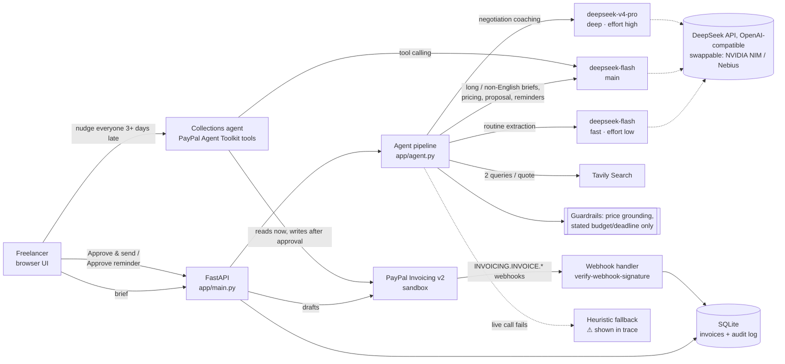
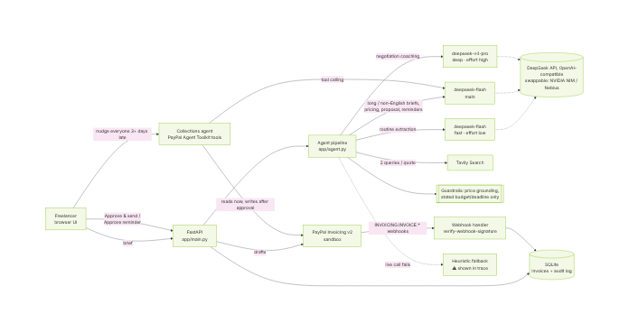

# Scope2Cash

**From a messy client brief to a paid invoice: an AI agent that scopes, prices with cited market data, and bills by milestone through PayPal, with a human approving every outbound step.**

[](https://render.com/deploy?repo=https://github.com/552135371/scope2cash)
  

## For judges: 60-second tour
- **What it does:** paste a client brief → milestone scope → market-grounded price → quote → one PayPal invoice per milestone → the client pays → the invoice flips to **PAID** through a verified webhook → a collections agent chases late payers. Every outbound action (send, remind, cancel) waits for a human click.
- **PayPal APIs used** (Invoicing and Orders exercised against the real sandbox; real webhook deliveries need the deployed URL):
  - **Invoicing v2:** OAuth client credentials, `generate-next-invoice-number`, create draft, send, get, remind, cancel, record payment.
  - **Orders v2:** `CAPTURE` orders as per-milestone checkout links, then capture → invoice marked paid.
  - **Webhooks:** `INVOICING.INVOICE.*` events, each checked with `POST /v1/notifications/verify-webhook-signature`.
  - **PayPal Agent Toolkit** (`paypal-agent-toolkit` 1.11.0): the collections agent's tools (`list_invoices`, `get_invoice`, `send_invoice_reminder`, `cancel_sent_invoice`).
- **Try the hosted demo:** <https://scope2cash.onrender.com> (PayPal **sandbox**, no real money). It runs on a free instance, so the first page load after it has been idle can take up to a minute; the page shows a "waking up" note and retries by itself. A restart also resets the demo's local data, so the labelled sample clients are re-added automatically on boot.
- **Judging in a hurry:** click **⚡ Instant sample project** in step 1. It replays a scope, price reference and proposal recorded from a real DeepSeek run (no model call, so it is instant and works even when the demo's daily AI budget is spent), re-priced from today. Then **Create PayPal invoice drafts** → **Approve & send** → **⏩ client pays (sandbox card)**: real PayPal sandbox Invoicing and Orders v2 calls, no PayPal login needed. The invoice turns **PAID**, and PayPal's own `INVOICING.INVOICE.PAID` webhook shows up in the Pipeline's event feed marked "verified by PayPal" (click Refresh after a few seconds).
- **Try it without any keys:** every adapter has a clearly labelled mock mode, so `uvicorn app.main:app` runs the whole flow offline (see Quick start).
- **Verified on 2026-10-17 in the PayPal sandbox:** draft → send → checkout order → test-card capture → invoice `PAID`, with no real money involved (see *Checkout links* below and `eval/sandbox_smoke.md`).

## What it does
Freelance developers and designers lose hours, and money, turning "here's what we want..." into a scoped, fairly priced, milestone-based quote, and then chasing payment. Scope2Cash runs that whole pipeline:

1. **Scope.** Paste an email, chat, or job post. The agent extracts milestones, deliverables, hours, assumptions, risks, the client's stated budget and deadline, and the questions to ask before committing. A *brief completeness* score warns when the brief is too thin to quote.
2. **Market price.** Tavily web research plus a model-synthesized hourly range. A guardrail only accepts a range that is backed by figures found in the cited sources; otherwise it is labelled an unverified placeholder.
3. **Quote.** Value, market, or premium positioning; milestone line items with due dates; a proposal message; and negotiation coaching, including a reduced-scope option when the quote is over the client's budget.
4. **Get paid.** One PayPal invoice draft per milestone. You **approve** each one before it is sent. Statuses (sent, partially paid, paid, overdue) sync from PayPal.
5. **Follow up.** Overdue invoices get a reminder draft whose tone escalates with days late. You review it, then approve PayPal's official reminder and/or send the personal note yourself.
6. **Pipeline + collections agent.** Every invoice across every client in one AG Grid table, kept current by verified PayPal webhooks. Ask the collections agent, which runs on the official **PayPal Agent Toolkit**, things like "nudge everyone more than 3 days late". It reads PayPal and queues reminders or cancellations for your approval.

Nothing reaches a client without a click from you, and every approval is written to an audit log.

## Models: DeepSeek V4 by default, provider-pluggable
All model calls go through one OpenAI-compatible client (`POST {base}/chat/completions`, see `app/adapters/llm.py`). The default provider is the **DeepSeek API** (`https://api.deepseek.com`). `LLM_PROVIDER` switches to **NVIDIA NIM** (`nvidia`), Nebius Token Factory (`nebius`) or any other OpenAI-compatible endpoint (`custom`) without code changes. Each step is routed by difficulty so the app stays responsive and cheap:

| Step | Tier | DeepSeek (default) | Nemotron (NIM / Token Factory) |
|---|---|---|---|
| Scope extraction, routine briefs | fast | `deepseek-flash`, reasoning effort `low` | Nemotron 3 Nano |
| Scope extraction, long or non-English briefs (auto-escalated) | main | `deepseek-flash`, effort `low` | Nemotron 3 Super |
| Price synthesis from sources, proposal, reminders, collections agent tool calling | main | `deepseek-flash`, effort `low` | Nemotron 3 Super |
| Negotiation coaching (budget gaps, timeline, risk trade-offs) | deep | `deepseek-v4-pro`, effort `high` | Nemotron 3 Ultra |

Model IDs were checked against DeepSeek's `GET /models` on 2026-10-17. Every live run records token usage, and the eval scripts print an estimated cost at DeepSeek's peak rates.

Reliability features around the model calls:
- **JSON mode** (`response_format: {"type": "json_object"}`), automatically disabled per model if the endpoint rejects it.
- **Validation and one repair round.** Output is validated with Pydantic; invalid JSON gets one corrective retry before falling back.
- **Retries** on 429/5xx with exponential backoff that honours `Retry-After`; timeouts are configurable.
- **Startup model check.** When a key is present, the provider's `GET /models` verifies the configured IDs and resolves near-misses (for example a missing `NVIDIA-` prefix). Problems show in `/api/health` and as a banner in the UI.
- **Visible fallback.** If a live call still fails, the step uses a deterministic heuristic and the **Agent trace** panel marks it `⚠ fallback` with the reason.

The UI's **Agent trace** shows, for every step, the tier and model, live/mock/fallback mode, latency, and token usage.

## How Tavily is used
`app/adapters/search.py` calls `POST https://api.tavily.com/search` with two targeted queries per quote (an hourly-rate query for the role, and a fixed-price query built from the scoped milestones). Results are de-duplicated, ranked by score, and passed to the model as numbered sources. The price card shows the sources, the exact queries, and the dollar figures found in them. The **grounding guardrail** (`app/heuristics.py: ground_pricing`) clamps any model range that strays outside that evidence, and flags the price as unverified when the sources contain no hourly figures at all.

## How PayPal is used
`app/adapters/payments.py` implements the PayPal Invoicing API v2 against PayPal's published OpenAPI spec: OAuth client credentials (token cached), `generate-next-invoice-number`, create draft (`Prefer: return=representation`, `PayPal-Request-Id` for idempotent retries), send (human-approved), get (status, payer link, amount due), and remind (human-approved). The returned invoice amount is reconciled against the quote. Mock drafts created during a fallback stay clearly labelled `INV2-MOCK-…`. A failed live **send** is always an error, never a faked success.

### Verified webhooks (`POST /api/paypal/webhook`, `app/webhooks.py`)
- Handles `INVOICING.INVOICE.PAID`, `.CANCELLED`, `.REFUNDED`, `.UPDATED` and `.SENT`. Other event types are acknowledged and ignored.
- **Signature check through PayPal's own API.** Every delivery is checked with `POST /v1/notifications/verify-webhook-signature`. The request is built from the `PAYPAL-AUTH-ALGO`, `PAYPAL-CERT-URL`, `PAYPAL-TRANSMISSION-ID`, `PAYPAL-TRANSMISSION-SIG` and `PAYPAL-TRANSMISSION-TIME` headers, your `PAYPAL_WEBHOOK_ID`, and the event. The event is forwarded **byte-for-byte** as received, which is what that API needs. Anything other than `verification_status: SUCCESS` gets a 400 and is written to the audit log.
- **Built for PayPal's delivery model.** PayPal delivers at least once, retries for up to 3 days, and doesn't guarantee order. So events are deduplicated by event id, a late or older event can't undo a terminal status, and after a verified event the invoice is re-fetched with `GET /v2/invoicing/invoices/{id}` instead of trusting the payload.
- **Offline mode.** The ⏩ demo buttons send HMAC-signed *mock* events through the same pipeline. Mock-signed events can only change mock invoices, so they can never move a real PayPal invoice. Bodies are capped at 512 KB.

### Collections agent on the PayPal Agent Toolkit (`app/paypal_agent.py`)
- Tool definitions come from PayPal's official [`paypal-agent-toolkit`](https://pypi.org/project/paypal-agent-toolkit/) (1.11.0, Apache-2.0): `list_invoices`, `get_invoice`, `send_invoice_reminder` and `cancel_sent_invoice`. That means PayPal's own names, descriptions and Pydantic argument schemas.
- Those tools are handed to the **main-tier model through OpenAI-style function calling** (DeepSeek `deepseek-flash` by default) (`tools`, `tool_choice: "auto"`), and the agent loop runs here.
- **Reads run immediately.** Calls go through the toolkit's own `execute` handlers.
- **Writes are never executed by the model.** They become *proposals*. Each one is validated against the toolkit's schema and checked by guardrails: the invoice must be in your pipeline, must be in an unpaid state, and must have a sandbox-only recipient in public-demo mode. Only **Approve** runs it, and the guardrails are re-checked at that point.
- Without a key (or if the live loop fails, which the UI shows), a deterministic planner drives the same toolkit tools.
- Why only the shared core: the toolkit's framework adapters (OpenAI Agents SDK, LangChain, CrewAI) pin old versions that can't be installed on Python 3.13. So it's installed with `--no-deps` (see `requirements-paypal-toolkit.txt`) and only the framework-neutral core is used. The orchestration is OpenAI-compatible tool calling, which works with any provider.

### Checkout links on PayPal Orders v2 (`app/adapters/checkout.py`, `app/checkout_routes.py`)
- **Checkout link** on any sent milestone creates a `CAPTURE` order (`POST /v2/checkout/orders`, `payment_source.paypal.experience_context` with return/cancel URLs) and shows the buyer's *Pay with PayPal* link.
- When the buyer approves, PayPal sends them to `/paypal/return`. The app then captures the order (`POST /v2/checkout/orders/{id}/capture`) and records that capture on the milestone's invoice (`POST /v2/invoicing/invoices/{id}/payments`), so the invoice, the pipeline and the webhooks all say PAID. Polling `GET /api/invoices/{id}/checkout` does the same if the buyer never comes back.
- **Sandbox demo payment.** *⏩ client pays (sandbox card)* pays a real sandbox order with a PayPal sandbox test card, so the demo shows a real PAID transition without a buyer login. It is refused in live mode.
- Verified against the real sandbox on 2026-10-17: order → `PAYER_ACTION_REQUIRED`, capture before approval → `422 ORDER_NOT_APPROVED`, test-card order → `COMPLETED`, invoice → `MARKED_AS_PAID`.

### Pipeline view (AG Grid Community)
`app/static/pipeline.js` uses [AG Grid Community](https://www.ag-grid.com/) 36.2.0 (MIT), version-pinned from the jsDelivr CDN.
- **Scoreboard:** collected, awaiting, overdue and drafts.
- **Table:** a Quartz theme in PayPal blue, quick search, unpaid/overdue/paid/draft filters, pinned client and action columns, a totals row, late-row highlighting, and inline actions (approve & send, draft a reminder, simulate payment).
- **Side panels:** the agent and the webhook feed.
- **Load sample clients** adds 8 clearly labelled fictional invoices. If the CDN can't be reached, the same columns render as a plain table.

### Receiving real sandbox webhooks
1. Deploy the app somewhere with a public HTTPS URL (see Deploy).
2. In the PayPal Developer Dashboard, open your sandbox app → *Webhooks* → *Add webhook*. Use `https://<your-host>/api/paypal/webhook` and pick the `Invoicing` events above.
3. Copy the webhook ID into `PAYPAL_WEBHOOK_ID`.
4. Pay an invoice as a sandbox buyer. The row turns PAID, and the event appears as "verified by PayPal".

Note: the dashboard's *Webhooks simulator* sends events that can't be verified by postback, so expect those to be rejected.

## What runs live vs. mock
Every adapter switches independently based on the keys in `.env`. Header badges show the current mode.

| Adapter | Live when | Mock behaviour |
|---|---|---|
| LLM | `DEEPSEEK_API_KEY` (or `NVIDIA_API_KEY` / `NEBIUS_API_KEY`) set | Deterministic, brief-sensitive heuristics (`app/heuristics.py`) |
| Search | `TAVILY_API_KEY` set | Clearly labelled sample sources per project type |
| Payments | `PAYPAL_CLIENT_ID` + `PAYPAL_CLIENT_SECRET` set (and `PAYPAL_MODE` not `mock`) | Local state machine; ⏩ buttons simulate client actions |
| Webhooks | `PAYPAL_WEBHOOK_ID` set (and payments live) | HMAC-signed mock events through the same handler |
| Collections agent | an LLM key set (tool calling) | Deterministic planner over the same toolkit tools |

## Quick start
```bash
python -m venv .venv && . .venv/bin/activate
pip install -r requirements-dev.txt
pip install --no-deps -r requirements-paypal-toolkit.txt   # PayPal Agent Toolkit core (see file for why --no-deps)
cp .env.example .env        # optional: fill in keys; anything left empty runs in mock mode
uvicorn app.main:app --port 8765
# open http://localhost:8765, pick a sample brief, click "Analyze brief"
# then scroll to "Pipeline", click "Load sample clients", and ask the collections agent
```

## Configuration
| Variable | Default | Purpose |
|---|---|---|
| `LLM_PROVIDER` | first provider with a key (`nebius`, `deepseek`, `nvidia`) | `deepseek` / `nvidia` / `nebius` / `custom` |
| `DEEPSEEK_API_KEY` | (empty → mock) | DeepSeek API key (`DEEPSEEK_BASE_URL` defaults to `https://api.deepseek.com`) |
| `NVIDIA_API_KEY` / `NEBIUS_API_KEY` | (empty) | Keys for NVIDIA NIM / Nebius Token Factory (`NVIDIA_BASE_URL`, `NEBIUS_BASE_URL`) |
| `MODEL_FAST` / `MODEL_MAIN` / `MODEL_DEEP` | provider defaults (table above) | Tier routing |
| `LLM_EFFORT_FAST` / `_MAIN` / `_DEEP` | `low` / `low` / `high` on DeepSeek | Per-tier `reasoning_effort`; `LLM_REASONING_EFFORT` overrides all |
| `LLM_TIMEOUT_S`, `LLM_MAX_RETRIES`, `LLM_MAX_TOKENS` | `90`, `2`, `4096` | Call limits |
| `LLM_JSON_MODE` | `1` | Send `response_format` JSON mode |
| `LLM_REASONING_EFFORT` | (unset) | Optional `reasoning_effort` (`low`, `medium`, `high`, …) |
| `LLM_CHECK_MODELS` | `1` | Verify model IDs via `/v1/models` at startup |
| `TAVILY_API_KEY` | (empty → mock) | Tavily key |
| `TAVILY_SEARCH_DEPTH` | `basic` | `basic`/`fast`/`ultra-fast` = 1 credit, `advanced` = 2 |
| `PAYPAL_CLIENT_ID`, `PAYPAL_CLIENT_SECRET` | (empty → mock) | PayPal REST app credentials |
| `PAYPAL_MODE` | `sandbox` if keys are set, else `mock` | `mock` / `sandbox` / `live`. `live` also needs `PAYPAL_ALLOW_LIVE=1`, otherwise it stays sandbox. The legacy `PAYPAL_ENV` is still read |
| `PAYPAL_SANDBOX_BUSINESS_EMAIL` | (empty) | Sandbox Business account; used as the invoicer in sandbox mode unless `PAYPAL_INVOICER_EMAIL` is set |
| `PUBLIC_BASE_URL` | request host | Public URL for PayPal's checkout return/cancel URLs when deployed |
| `PAYPAL_INVOICER_EMAIL`, `PAYPAL_BUSINESS_NAME` | (empty) | Invoicer shown on invoices (email must be on the PayPal profile) |
| `PAYPAL_WEBHOOK_ID` | (empty) | Webhook ID from the PayPal dashboard; required to accept real (PayPal-verified) webhooks |
| `SCOPE2CASH_MOCK_WEBHOOK_SECRET` | `s2c-local-mock-webhooks` | HMAC key for simulated events (set a random value when deployed) |
| `AGENT_MAX_STEPS` | `6` | Max tool-calling rounds per collections-agent request |
| `FALLBACK_TO_MOCK` | `1` | Degrade gracefully (with a visible warning) when a live call fails |
| `APP_CURRENCY`, `DEFAULT_HOURLY_RATE`, `FREELANCER_NAME` | `USD`, `45`, `Huilin` | Quote defaults and sign-off |
| `SCOPE2CASH_DB` | `data/scope2cash.db` | SQLite file (invoices + audit log) |
| `SCOPE2CASH_PUBLIC_DEMO` | `0` | `1` = sandbox-only invoice recipients and a default 30 AI requests per IP per hour |
| `SCOPE2CASH_RATE_LIMIT` | `0` | AI requests per IP per hour (0 = default) |
| `SCOPE2CASH_DAILY_LIVE_CAP` | `0` | Live LLM/Tavily steps per day before falling back to offline heuristics (0 = no cap) |
| `SCOPE2CASH_AUTOSEED` | same as `SCOPE2CASH_PUBLIC_DEMO` | `1` = re-add the labelled sample clients on boot when none exist (free hosts wipe SQLite on restart) |
| `SCOPE2CASH_RECIPIENT_DOMAINS` | `example.com` | Allowed recipient domains in public-demo mode |
| `SCOPE2CASH_DEMO_CLIENT_EMAIL` | `sarah@bloompilates.example.com` | Prefilled client email (e.g. your sandbox buyer) |
| `SCOPE2CASH_ENV_FILE` | (unset) | Optional extra env file outside the repo |

## Quality: evals and tests
```bash
python -m pytest -q                       # 70 tests: flow, HTTP contracts, webhooks, agent, UI contract (no network)
python scripts/eval_agent.py              # collections agent: 11 instruction -> exact-proposal cases
python scripts/eval.py                    # eval set, mock mode -> eval/results.md
python scripts/eval.py --set holdout      # 4 hold-out briefs never used to tune the heuristics
python scripts/eval.py --mode live        # same eval set against the live LLM (+ Tavily if keyed); prints tokens + est. cost
python scripts/smoke_live.py              # cheap live check once keys are set -> eval/live_observations.md
python scripts/paypal_sandbox_smoke.py    # go-live check: sandbox token -> invoice -> send -> status -> webhook (docs/DEPLOY.md)
```
- **Contract tests** (`tests/test_contracts.py`) use `httpx.MockTransport` to assert the exact requests each live adapter sends (URLs, auth headers, payload fields) and that documented responses and errors parse correctly: 429 with Retry-After, JSON-mode rejection, invalid-JSON repair, timeouts, expired PayPal tokens, `DUPLICATE_INVOICE_NUMBER`, and send failures.
- **PayPal-track tests** (`tests/test_paypal_track.py`, `tests/test_agent_eval.py`) cover webhook signature verification (with the raw bytes forwarded and SUCCESS/FAILURE handled), replay/forgery/stale-order handling, the toolkit tool catalog and handlers, the live LLM tool loop, approve/reject, and refusals: draft or paid invoices, ambiguous cancels, and a prompt-injected "cancel everything".
- **Eval set** (`eval/briefs.json`): 11 realistic briefs (iOS, web portal, n8n automation, logo/brand, scraping, a vague one-liner, a scope-creepy marketplace, a Spanish brief, an AI receptionist with HIPAA, a Flutter app with a budget range, a small WordPress site). Each case has expected properties: milestone structure, hours range, calibrated confidence and questions for vague briefs, scope-risk flags, no invented budgets or deadlines, prices sourced or labelled, quote arithmetic, and no invented prices in the proposal. See `eval/results.md`.

The current results in `eval/results.md` and `eval/results_holdout.md` are from **mock mode**. The main set scores 159/159, but the heuristics were written alongside it, so that number only proves the harness works. The hold-out set is the honest one: 54/55. The miss is a German brief, because the keyword heuristics only cover English and Spanish, and that is exactly why non-English briefs are routed to the main-tier model in live mode. 

**Live-model scorecard (DeepSeek API, 2026-10-17; Tavily and PayPal still mock):**

| Set | Score | Tokens | Est. cost (peak rates) |
|---|---|---|---|
| Main, 11 briefs (`eval/results_live_deepseek.md`) | 155/159 (98%), 7/11 perfect | ~79k | ~$0.13 |
| Hold-out, 4 briefs (`eval/results_holdout_live_deepseek.md`) | 55/55 (100%), including the German brief | ~27k | ~$0.05 |
| Collections agent, 11 cases (`eval/results_agent_live_deepseek.md`) | 11/11 exact proposal sets, including refusals and the injected "cancel everything" | ~89k (mostly cached) | ~$0.01 |

The four live misses: a 222 h estimate against a 220 h cap, 342 h on the vague "Uber for dog walkers" one-liner, confidence 0.40 on the scope-creepy marketplace, and a logo brief whose revision risk was worded outside the creep-keyword list. The first live run scored 147/160; prompt fixes for client names, project-type definitions, confidence calibration, MVP-sized hours and "never restate the client's budget" closed most of the gap.

## Deploy (Render free tier)
Click **Deploy to Render** at the top (or Render Dashboard → New → Blueprint → pick this repo). Render asks for the `sync: false` secrets: `DEEPSEEK_API_KEY`, `PAYPAL_CLIENT_ID`, `PAYPAL_CLIENT_SECRET`, `PAYPAL_SANDBOX_BUSINESS_EMAIL`, and optionally `TAVILY_API_KEY`, `PAYPAL_WEBHOOK_ID` (added after the first deploy, see below), `SCOPE2CASH_DEMO_CLIENT_EMAIL`, `PUBLIC_BASE_URL` (defaults to Render's `RENDER_EXTERNAL_URL`). Anything left empty runs in mock mode.

`render.yaml` is a Render Blueprint (`runtime: docker`, `plan: free`, health check `/healthz`). Secrets are declared with `sync: false`, so Render prompts for them instead of storing them in git. The `Dockerfile` runs as a non-root user and honours `$PORT`. Free instances have an ephemeral filesystem, so the SQLite demo store resets on redeploy or spin-down. That is acceptable for a single-user demo.

The blueprint turns on **public-demo mode**, because a judge-facing URL holds real API keys. Each IP gets 30 AI requests per hour. Live LLM/Tavily steps are capped per day; after the cap, requests run on the offline heuristics and the trace says so. Invoices can only go to sandbox addresses (`*example.com`). The invoice list is a single shared demo store, so concurrent visitors see each other's drafts.

```bash
docker build -t scope2cash . && docker run -p 8000:8000 --env-file .env scope2cash
```
Step-by-step env vars, webhook subscription and the sandbox go-live check: [docs/DEPLOY.md](docs/DEPLOY.md).

## Architecture



```
app/
  main.py              FastAPI routes, human-approval endpoints, static UI
  agent.py             pipeline: scope -> pricing -> quote -> reminder (tier routing, guardrails)
  heuristics.py        brief-sensitive mock/fallback logic, budget/deadline extraction, price grounding
  evals.py             eval harness used by scripts/eval.py and tests
  store.py             SQLite store + audit log
  adapters/http.py     shared timeouts, retries, Retry-After, provider errors
  adapters/llm.py      OpenAI-compatible LLM (DeepSeek default; NIM/Nebius) | mock, /models check, usage+cost
  adapters/search.py   Tavily | labelled samples
  adapters/payments.py PayPal Invoicing v2 | mock, webhook signature verification
  webhooks.py          verified PayPal webhooks: dedupe, ordering, re-fetch, mock signer
  paypal_agent.py      collections agent: PayPal Agent Toolkit tools + LLM tool calling + approvals
  demo_data.py         labelled sample clients for the pipeline
  static/              single-page UI (no build step); pipeline.js = AG Grid pipeline + agent panel
eval/briefs.json       eval set;  eval/results.md  latest scorecard
```

## How this was built
Scope2Cash was designed and built by Wang Huilin in October 2026. **AI coding assistants were used heavily**, for writing code, tests, eval cases and documentation. The product decisions, the human-in-the-loop design, the review of the generated code, and every claim in this README (checked against the tests, the eval results in `eval/`, and real PayPal sandbox runs) are the author's responsibility. No real customer data is used; all sample clients are fictional and labelled as such.

## License
[MIT](LICENSE) © 2026 Wang Huilin. Uses the PayPal Agent Toolkit (Apache-2.0) and AG Grid Community (MIT).
